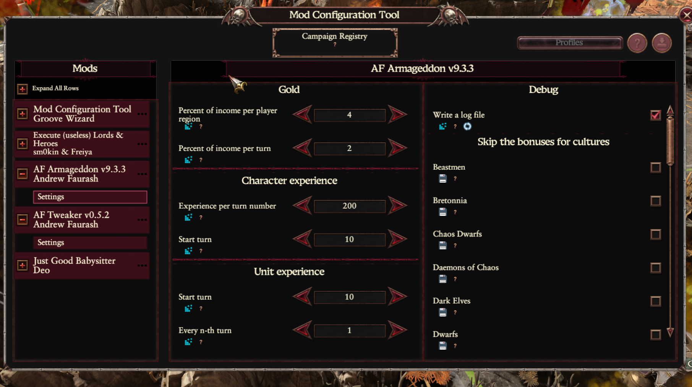

# AF Armageddon — User Guide

AF Armageddon is a campaign mod for *Total War: Warhammer 3* that makes the middle and late game
harder. On each of their turns AI factions get bonuses, and these bonuses grow as the campaign
goes on:

- gold, which grows with the turn number and with the number of your regions;
- experience for their characters;
- experience for the units in their armies;
- an effect bundle with research, recruitment and growth.

By default only the factions outside your culture group get them.

## Installation

1. Subscribe to [AF Armageddon](https://steamcommunity.com/sharedfiles/filedetails/?id=3665832094).
2. Subscribe to [Mod Configuration Tool](https://steamcommunity.com/sharedfiles/filedetails/?id=2927955021)
   (MCT). It provides the settings window. Without it the mod still works with the default
   settings, but you can't change them.
3. Enable both in the launcher. The order of the mods doesn't matter.

You can add the mod to a running campaign. Don't remove it afterwards, see
[Good to know](#good-to-know).

## Settings



Open the Mod Configuration Tool window in the game and choose **AF Armageddon**, then **Settings**.
The version of the mod is shown in its title.

| Section | Option | Default | What it does |
|---|---|---:|---|
| Who gets the bonuses | AI factions of your culture | Off | They get the bonuses too |
| Who gets the bonuses | AI factions of your culture group | Off | The other cultures of your group get them too |
| Gold | Percent of income per player region | 4 | Each of your regions adds this share of the AI income, 0-100 |
| Gold | Percent of income per turn | 2 | Each turn of the campaign adds this share of the AI income, 0-100 |
| Character experience | Experience per turn number | 200 | Multiplied by the turn number, 0-5000 |
| Character experience | Start turn | 10 | The first turn with this bonus, 1-200 |
| Unit experience | Start turn | 10 | The first turn with this bonus, 1-200 |
| Unit experience | Every n-th turn | 1 | How often a unit gets a whole extra rank: 1 is every turn, 3 is only the turns divisible by 3, up to 50 |
| Debug | Write a log file | Off | Writes a log, useful for finding problems |

The settings are the same for all your campaigns. A change takes effect from the next turn of
an AI faction.

## Who gets the bonuses

An AI faction gets the bonuses when its culture is outside your culture group. Only the culture
counts: alliances, vassals and wars change nothing. Rebels never get them.

The two options in the first section widen this. For example, when you play as the Empire:

| Faction | By default | With "your culture group" | With "your culture" |
|---|---|---|---|
| Greenskins | Yes | Yes | Yes |
| Dwarfs | No | Yes | No |
| Another Empire faction | No | No | Yes |

The two options are independent, so you can turn on both.

The culture groups are:

- Empire, Bretonnia, Dwarfs, Kislev, Cathay;
- High Elves, Wood Elves;
- Warriors of Chaos, Daemons of Chaos, Khorne, Nurgle, Slaanesh, Tzeentch, Norsca, Beastmen;
- Tomb Kings, Vampire Counts, Vampire Coast, Undead Legions.

Chaos Dwarfs, Dark Elves, Skaven, Ogre Kingdoms, Lizardmen, Greenskins and Rogue Armies are
groups of their own.

A culture from a new DLC or another mod that isn't on this list belongs to no group, so it gets
the bonuses, and it's written once to the error file.

## What the AI gets

### Gold

From the first turn, on each of its turns a faction gets a share of its income:

```
income × (turn × percent per turn + your regions × percent per region)
```

So the gold grows on its own as the campaign goes on, and faster when you expand. With the
default settings, on turn 44 with 61 regions the share is 44 × 2% + 61 × 4% = 332%: a faction
with an income of 6,691 gets 22,214 gold on that turn.

### Character experience

From the start turn, on each of its turns every character of the faction gets the turn number
multiplied by **Experience per turn number**. With the default settings that's 2,000 on turn 10
and 8,800 on turn 44.

### Unit experience

From the start turn, every unit in an army with a general gets one rank, up to rank 9.

**Every n-th turn** counts from the start of the campaign, not from the start turn. With 3 and
the start turn 10, units get a rank on turns 12, 15, 18 and so on.

### Effect bundle

This bonus has no settings. Each faction has one bundle at a time, the one of the current turn:

| From turn | Research rate | Local recruitment capacity | Growth |
|---:|---:|---:|---:|
| 10 | +50 | +2 | +20 |
| 20 | +70 | +4 | +40 |
| 30 | +100 | +6 | +60 |
| 35 | +150 | +8 | +80 |
| 40 | +200 | +10 | +100 |

Research applies to the faction, recruitment and growth to each of its provinces. The bundle
lasts two turns and is renewed every turn, so when a faction stops getting the bonuses it
loses the bundle soon after.

## Compatibility with other mods

AF Armageddon was made to be used with **Radious**, and it's compatible with any other mod.

- It consists of a script and its own effect bundles, and it doesn't change any existing game
  data.
- The order of the mods doesn't matter.
- The gold depends on the AI income, so mods that change the economy change this bonus too.

## Balance

Balance depends on many things: mods, factions, random events, your skills and your style. All
you can expect is that the difficulty gradually grows.

If it's too hard, lower the two gold percents or move the start turns later. If it's too easy,
raise them, or give the bonuses to your culture and your culture group too.

## Good to know

- The mod is made for single player campaigns. It isn't designed for multiplayer and doesn't
  support it.
- Don't remove the mod from a running campaign: saves made with a mod may fail to load or crash
  without it. See [how to remove a mod](wh3-removing-a-mod.md).
- Turning a bonus off doesn't take back what the AI has already got.
- The mod's files are in the game folder, next to the game itself:
  - `!!af_armageddon.txt` — the log, if it's turned on;
  - `!!af_armageddon-errors.txt` — errors, if there were any.
- The log grows fast, close to 1 MB per turn in a late game. Turn it on only to find a problem.
