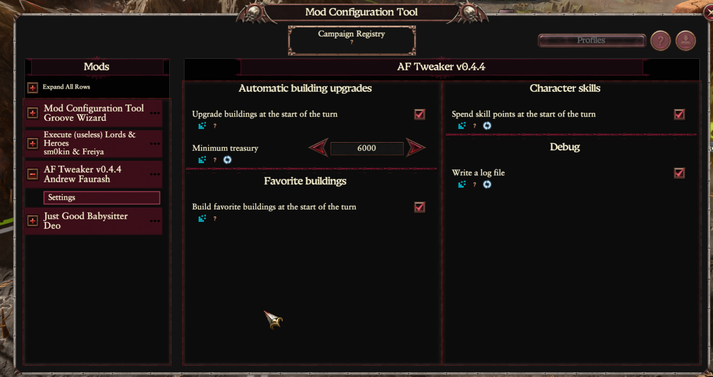
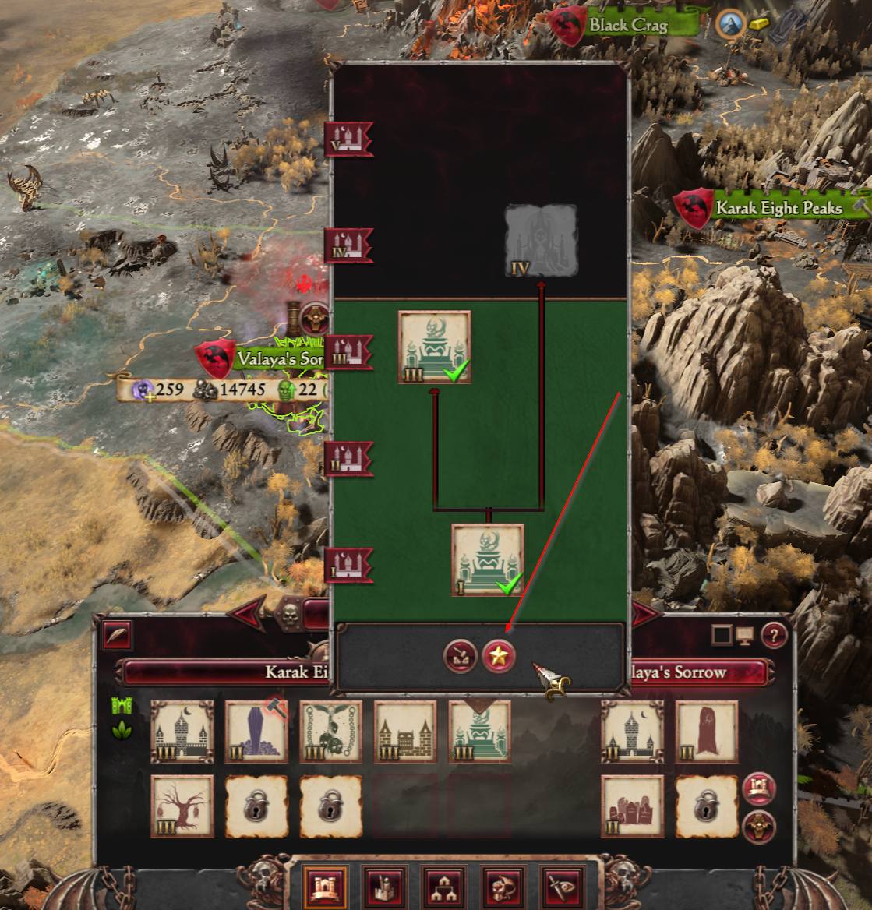
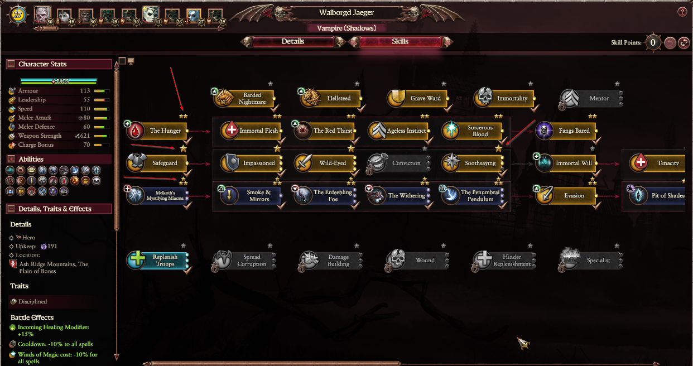

# AF Tweaker — User Guide

AF Tweaker is a campaign mod for *Total War: Warhammer 3* that takes routine work off your
hands at the start of each of your turns:

- it queues building upgrades;
- it builds the buildings you marked as favorites;
- it spends your characters' skill points.

Each of these can be turned on or off.

## Installation

1. Subscribe to [Mod Configuration Tool](https://steamcommunity.com/sharedfiles/filedetails/?id=2927955021)
   (MCT). It provides the settings window. Without it the mod still works with the default
   settings, but you can't change them, and automatic skills stay off.
2. Enable AF Tweaker and MCT in the launcher. The order of the mods doesn't matter.

The mod keeps nothing in your saves, so you can add it to a running campaign.

## Settings

Open the Mod Configuration Tool window in the game and choose **AF Tweaker**, then **Settings**.
The version of the mod is shown in its title.

| Option | Default | What it does |
|---|---:|---|
| Upgrade buildings at the start of the turn | On | Queues building upgrades |
| Minimum treasury | 5000 | The money the mod never spends on buildings |
| Build favorite buildings at the start of the turn | On | Builds your favorite buildings |
| Spend skill points at the start of the turn | **Off** | Spends skill points and shows the priority stars |
| Write a log file | Off | Writes a log, useful for finding problems |

The settings are the same for all your campaigns. A change takes effect from your next turn.

## Minimum treasury

Buildings are paid for only with the money above the minimum. With 20,000 in the treasury and a
minimum of 6,000, the mod can spend up to 14,000 in a turn.

Favorite buildings go first, and upgrades get what's left. If a building is too expensive, the
mod moves on to the next one, because a cheaper one may still fit.

## Automatic building upgrades

At the start of your turn, every building that can be upgraded and fits the budget is queued.

A building is left alone when:

- its settlement is under siege;
- it's already being built or upgraded;
- the upgrade needs a technology or a higher settlement level;
- the upgrade costs something other than gold that you can't pay;
- it can be upgraded in several different ways. This choice is yours, so make it yourself.

## Favorite buildings

Favorite buildings are built automatically in free building slots.

To mark a building, hover over it in the settlement panel and click the **star** next to the
demolish button. The star lights up. Click it again to remove the building from the favorites.

- You can click the star on any level of a building: the mod builds its first level, and
  automatic upgrades take it further.
- The star is meant for optional buildings, not for the main building of a settlement.
- The star is available in the settlement panel, not in the Building Browser.
- Favorites are built in the order you marked them, at most one of each per settlement per turn.
- The game's own rules still apply: the mod builds only what you could build yourself in
  that slot.
- Favorites are shared by all your campaigns. Buildings of other factions are simply ignored.

## Automatic character skills

This feature is off by default. When it's on, your characters spend all their available skill
points at the start of your turn.

Each skill card in the character panel gets a small star above it. Click it to set a priority:

| Star | Priority |
|---|---|
| Grey | None |
| One gold star | 1 |
| Two gold stars | 2 |
| Three gold stars | 3 |

A fourth click clears the priority. Skills with a higher priority get points first, then the
skills without a priority, in the order of the skill tree.

- Priorities belong to the skill, so they apply to every character who has that skill, in all
  your campaigns.
- A skill with several levels gets several points, up to its maximum.
- Locked skills are skipped, and points aren't saved for them, even if the skill has a high
  priority. Points go to whatever can be bought now.
- A skill unlocked by this turn's points gets its points next turn.
- Wounded characters are skipped.
- It works separately from the game's own auto-management of skills.

> **Before you turn this on:** on your next turn every character will spend all their
> unspent points, including on skills without a priority. Set the priorities for your important
> characters first, and make a save. The only way to undo a choice is the game's skill reset.

## Compatibility with other mods

AF Tweaker is meant to work alongside other mods, and it was tested in a campaign with
**Radious**.

- It doesn't change any game tables and doesn't replace any game interface files. It consists
  of scripts and a few icons of its own, so it doesn't conflict with mods over them.
- Costs, buildings and skills are read from the game while it runs, so changes made by other
  mods are taken into account. Buildings and skills added by other mods work like vanilla ones:
  they get the star too.
- The order of the mods doesn't matter.
- Mods that also build, upgrade or spend skill points automatically can work at the same time.
  Whichever acts first takes the money or the points, so it's better to leave only one of them
  on for each job.
- A mod that replaces the building popup or the skill tree can hide the stars. The game keeps
  working, but you may not be able to mark buildings or set priorities.

## Good to know

- The mod doesn't work in multiplayer campaigns.
- The mod's files are in the game folder, next to the game itself:
  - `!!af_tweaker-favorites.txt` — your favorite buildings;
  - `!!af_tweaker-skill-priorities.txt` — your skill priorities;
  - `!!af_tweaker.txt` — the log, if it's turned on;
  - `!!af_tweaker-errors.txt` — errors, if there were any.
- Delete the first two files to clear your favorites and priorities. Do it with the game closed.
